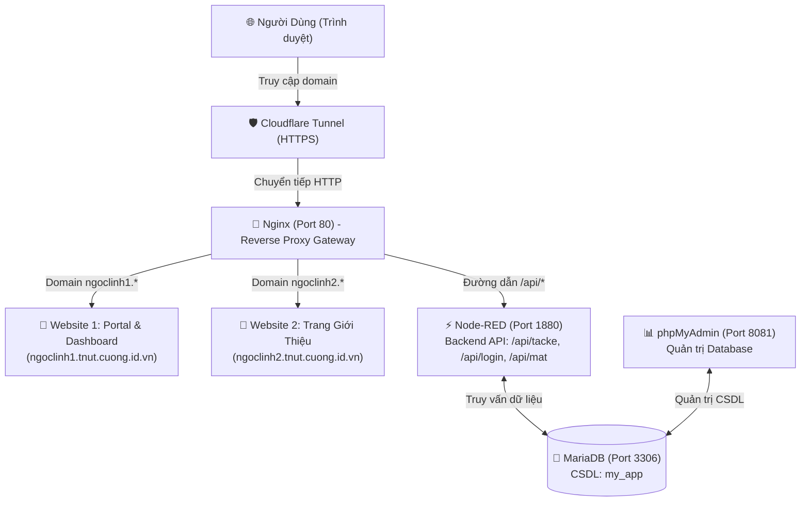

# Hạ Tầng Web & Hệ Thống Dịch Vụ Với Docker, Nginx, Node-RED

Dự án này là hệ thống web hoàn chỉnh do mình xây dựng nhằm tìm hiểu sâu về kiến trúc triển khai dịch vụ web trong thực tế: từ việc đóng gói bằng Docker Compose, cấu hình Nginx làm Reverse Proxy chạy nhiều domain, xây dựng backend API bằng Node-RED, lưu trữ CSDL với MariaDB cho đến giải pháp đưa website ra ngoài Internet bằng Cloudflare Tunnel.

* **Người thực hiện:** Nguyễn Thị Ngọc Linh 

---

## 1. Mục tiêu và bài toán giải quyết

Khi mới làm web, mình thường chạy trực tiếp mọi thứ trên máy: cài Node.js, cài Apache/IIS, cài MySQL... Cách này rất dễ gây xung đột cổng mạng, khó quản lý và khi chuyển sang máy khác chạy thì lỗi tùm lum.

Để giải quyết vấn đề đó, trong dự án này mình chuyển sang cách làm chuyên nghiệp hơn:
1. **Dùng Docker Compose** gom toàn bộ 5 dịch vụ (`nginx`, `nodered`, `mariadb`, `phpmyadmin`, `cloudflared`) vào một mạng nội bộ (`app_network`). Muốn chạy chỉ cần gõ đúng một lệnh.
2. **Dùng Nginx làm cổng đón khách (Reverse Proxy):**
   - Chạy đồng thời 2 website với 2 tên miền khác nhau trên cùng 1 địa chỉ IP duy nhất (Virtual Host).
   - Chuyển tiếp các yêu cầu `/api/` ngầm về Node-RED để trang web gọi API mà **không bao giờ bị lỗi CORS**.
3. **Xây dựng API trên Node-RED:**
   - Cung cấp dữ liệu sinh viên kèm số tiền để frontend hiển thị, tìm kiếm và tính tổng tiền tự động.
   - Xây dựng cơ chế đăng nhập xác thực qua HTTP Cookie, bảo vệ trang dữ liệu mật nếu chưa đăng nhập.
4. **Cơ sở dữ liệu tự động:** Khởi tạo sẵn bảng và dữ liệu mẫu trong MariaDB ngay khi bật container.
5. **Đưa web lên Internet:** Dùng Cloudflare Tunnel để truy cập từ ngoài mạng qua tên miền riêng mà không cần mở port modem hay mua IP tĩnh.

---

## 2. Kiến trúc hoạt động của hệ thống

Sơ đồ kết nối giữa các thành phần:



---

## 3. Cấu trúc thư mục dự án

```text
modern-web-infrastructure/
├── docker-compose.yml       # Tệp điều phối 5 dịch vụ
├── .env.example             # Tệp mẫu lưu biến môi trường (token, mật khẩu)
├── .gitignore               # Bỏ qua các file rác và file tạm
├── nginx/
│   └── nginx.conf           # Cấu hình 2 virtual host và reverse proxy /api/
├── nodered/
│   └── flows.json           # Toàn bộ luồng API xây dựng trên Node-RED
├── mariadb/
│   └── init.sql             # Script tự động tạo bảng và nạp dữ liệu mẫu
├── html/                    # Thư mục chứa mã nguồn các website
│   ├── web1/                # Website 1: Giao diện gọi API + Đăng nhập Cookie
│   │   ├── index.html
│   │   └── app.js
│   └── web2/                # Website 2: Trang web độc lập chứng minh đa tên miền
│       └── index.html
└── README.md                # Báo cáo kỹ thuật chi tiết
```

---

## 4. Chi tiết các phần mình đã làm

### 4.1. Cấu hình Nginx đa tên miền và chống lỗi CORS
Trong file `nginx/nginx.conf`, mình chia làm 2 khối `server`:
* **Website 1:** Lắng nghe domain `ngoclinh1.tnut.cuong.id.vn` và `localhost`, trỏ thư mục gốc về `/usr/share/nginx/html/web1`.
* **Website 2:** Lắng nghe domain `ngoclinh2.tnut.cuong.id.vn` và `web2.localhost`, trỏ về `/usr/share/nginx/html/web2`.
* **Chuyển tiếp API:** Cả 2 site đều có đoạn:
  ```nginx
  location /api/ {
      proxy_pass http://nodered:1880/api/;
      proxy_set_header Host $host;
      proxy_set_header X-Real-IP $remote_addr;
  }
  ```
  Nhờ đó trên file `app.js`, mình chỉ cần gõ lệnh `fetch('/api/tacke')` là trình duyệt tự hiểu và gửi qua Nginx, không bị trình duyệt chặn vì khác domain hay khác cổng (CORS).

### 4.2. Xây dựng API và Xác thực Cookie trên Node-RED
Trong `nodered/flows.json`, mình thiết kế 4 endpoint:
* `GET /api/tacke`: Trả về danh sách sinh viên kèm tiền. Bên giao diện `web1` có thêm ô tìm kiếm để lọc danh sách theo tên và tự cộng dồn tổng số tiền.
* `POST /api/login`: Nhận `uid` và `pwd`. Nếu đúng thông tin, Node-RED trả về chuỗi mã `session_...`. Phía JavaScript sẽ lưu mã này vào Cookie trình duyệt (thời hạn 7 ngày).
* `POST /api/check_logined`: Mỗi lần mở lại web, JS tự gửi Cookie lên kiểm tra, nếu hợp lệ sẽ tự động hiển thị trạng thái đã đăng nhập mà không cần gõ lại tài khoản.
* `POST /api/mat`: Chỉ khi nào gửi kèm Cookie hợp lệ thì server mới trả về bảng điểm cá nhân; nếu không đăng nhập thì sẽ bị từ chối.

### 4.3. Tự động hóa cơ sở dữ liệu với MariaDB
Thay vì phải vào phpMyAdmin tạo bảng thủ công, mình tạo file `mariadb/init.sql` và mount vào `/docker-entrypoint-initdb.d/init.sql` trong `docker-compose.yml`.
Lần đầu tiên container MariaDB khởi động, nó sẽ tự động chạy file này để:
* Tạo bảng `SinhVien` và chèn sẵn 5 sinh viên mẫu.
* Tạo bảng `Users` có tài khoản `ngoclinh`, `admin`, `duycop`.
* Tạo bảng `Cookies` và bảng `Diem`.

### 4.4. Đưa web ra ngoài với Cloudflare Tunnel
Trong `docker-compose.yml`, dịch vụ `cloudflared` kết nối thẳng với Cloudflare qua token. Nhờ đó, người ngoài có thể truy cập website qua domain chính thức mà máy chủ của mình không cần mở bất kỳ cổng nào trên modem, vừa tiện vừa an toàn.

---

## 5. Sự cố thực tế từng gặp và cách mình sửa

Trong phiên bản bài làm trước đây, mình từng gặp lỗi **Nginx báo 404 Not Found** dù container vẫn chạy. 

* **Nguyên nhân:** Mình để thư mục `web1` và `web2` nằm ở ngoài thư mục gốc, nhưng trong `docker-compose.yml` lại khai báo mount `- ./html:/usr/share/nginx/html`. Khi đó Docker tạo ra một thư mục `html` rỗng và đè lên container, khiến Nginx tìm vào `/usr/share/nginx/html/web1` nhưng không thấy file nào.
* **Cách khắc phục ở bản này:** Mình tạo thư mục cha `html/` và đưa cả `web1/`, `web2/` vào bên trong. Cấu trúc thư mục trên máy thật lúc này khớp 100% với đường dẫn bên trong container Nginx, sửa dứt điểm lỗi 404.

---

## 6. Hướng dẫn chạy thử dự án

### Bước 1: Tải mã nguồn về máy
```bash
git clone https://github.com/k235480106043-a11y/modern-web-infrastructure.git
cd modern-web-infrastructure
```

### Bước 2: Khởi chạy bằng Docker Compose
```bash
docker compose up -d
```

### Bước 3: Kiểm tra trên trình duyệt
* **Website 1 (Trang chính & API):** [http://localhost](http://localhost)
  * Bấm nút **"Lấy Dữ Liệu API"** để tải danh sách và thử tìm kiếm theo tên.
  * Thử đăng nhập bằng tài khoản: `ngoclinh` | Mật khẩu: `123456` để kiểm tra lưu Cookie và xem bảng điểm mật.
* **Website 2 (Virtual Host thứ 2):** [http://web2.localhost](http://web2.localhost)
* **Quản trị Database phpMyAdmin:** [http://localhost:8081](http://localhost:8081) *(User: `root`, Password: `rootpassword`)*
* **Giao diện Node-RED:** [http://localhost:1880](http://localhost:1880)

Khi muốn dừng toàn bộ hệ thống:
```bash
docker compose down
```
